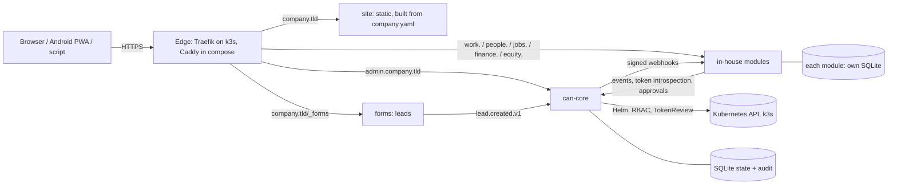

# Architecture

How the pieces fit together, as built. [SPEC.md](../SPEC.md) is the source of truth for the design and the
roadmap; this page describes what the code does today and marks where the picture only holds on a cluster.

## The pieces



**can-core** (`cmd/can-core`, `core/server/*`) is the only privileged, always-on component. It owns the admin UI
(password and TOTP, optional OIDC SSO), the module registry and capability map, RBAC and permissions namespaced
per module, the approval engine, notifications (inbox, email, Web Push), the event bus and the signed webhook
dispatcher, personal access tokens (PATs), and the hash-chained audit log. It talks to Kubernetes through
`TokenReview` (to know which module is calling) and, with `CAN_INSTALLER=kubernetes`, installs and upgrades
module charts. It keeps its state in SQLite.

**Modules** are separate processes, normally one pod per namespace (`mod-<id>`) under default-deny
NetworkPolicy, each with its own SQLite file, bearer-token store and manifest (`modules/<id>/module.yaml`:
permissions, approval types, published and subscribed events, provided capabilities, resource budget).
The in-house modules are Go services in `core/<module>` with a `cmd/can-<module>` binary: `forms`, `work`,
`people`, `jobs`, `finance`, `equity`. Wrapped open-source modules (support, newsletter, analytics, wiki, CRM,
status) are charts around upstream images. Analytics, support and newsletter are installed on k3d by an
advisory CI job, with a Postgres can-core runs in `can-data` for the last two (`specs/041-wrapped-modules-live`);
the others have never been started. Modules never call each other; they
publish events and call can-core, which delivers to subscribers.

**Events** are small JSON envelopes with ids only (no names or email addresses), published by a module to
can-core (`POST /v1/events`, idempotent on `source_id`) and delivered at least once as HMAC-signed webhooks to
the modules whose manifest `subscribes`, with eight retries and a dead-letter view in the admin UI. Receivers
verify the signature and the 5-minute replay window, check `source`, and de-duplicate by event id
([module-wiring.md](module-wiring.md)).

**Tokens.** A module authenticates to can-core with its projected ServiceAccount token (verified by
`TokenReview`; in compose a fake reviewer stands in). A person authenticates to a module with a personal access
token (`canpat_...`) issued in the admin UI for one module with chosen permissions; the module asks can-core to
introspect it. Each module also has a static bootstrap token for its own service account. Humans on the admin UI
use a session cookie after password and TOTP, or OIDC SSO ([sso.md](sso.md)); SSO covers the admin UI only.

**Approvals** are one engine in can-core: a module creates a request (`POST /v1/approvals`), can-core resolves a
chain of approvers from policy, records every step, and sends `approval.decided.v1` back to that module only
([approvals.md](approvals.md)).

**Backup** is a host-level restic timer over the dumps that can-core asks each module to write, plus the k3s
datastore and secrets key, with a recovery kit printed at install time ([backup-restore.md](backup-restore.md)).
`can restore` is not functional until the provisioning adapters exist.

**Local equivalents.** `make dev` is the same base manifests on k3d. The Docker Compose stack
([local-compose.md](local-compose.md)) runs the same binaries without Kubernetes: can-core records state only, the
modules run standalone and are not registered, and the Caddy edge replaces Traefik. That is why the flows below
are tested with the real services in `test/wiring` and not in the compose end-to-end suite.

## Lead capture

```mermaid
sequenceDiagram
  autonumber
  actor V as Visitor
  participant E as Edge
  participant S as site (static)
  participant F as forms
  participant C as can-core
  actor A as Sales user (admin UI)
  V->>E: GET company.tld/
  E->>S: page with the contact form
  V->>E: GET /_forms/contact/token
  E->>F: timing token (signed, short-lived)
  Note over V,F: the form is filled for at least min_fill_seconds
  V->>E: POST /_forms/contact (Origin = site, honeypot empty, token)
  E->>F: same origin, prefix stripped
  F->>F: check origin, honeypot, timing, rate limit; store lead in SQLite
  F-->>V: 303 thank-you
  F->>C: POST /v1/events lead.created.v1 (ids only, module token)
  C->>C: notification rule role:sales creates an inbox item
  A->>C: open Leads page
  C->>F: GET /v1/leads (leads capability, token file)
  F-->>A: the leads, shown in the admin UI
```

The event carries no personal data; the admin UI reads the lead itself from forms. forms has no durable
outbox: if can-core is down for the four delivery attempts, the lead is kept but its event is lost
([module-wiring.md](module-wiring.md), "What is not done"). In compose only steps 1 to 6 and a direct read of the
leads API are exercised.

## Hire handoff (jobs to people)

```mermaid
sequenceDiagram
  autonumber
  actor R as Recruiter
  participant J as jobs
  participant C as can-core
  participant P as people
  actor H as HR
  R->>J: POST /v1/applications/{id}/hire (from an offer stage, app.hire)
  J->>J: mark hired, audit
  J->>C: POST /v1/events candidate.hired.v1 (candidate id only)
  C->>C: authorise: jobs may publish it, people subscribes
  C->>P: signed webhook /v1/can/events
  P->>P: verify signature and source = jobs; once per candidate id
  P->>P: create a person in onboarding ("New hire" + candidate id) and the onboarding checklist
  H->>P: fill in the real details, assign the checklist tasks
  Note over P: identity.provision tasks cannot be completed by the person they are about
```

people does not yet fetch the hire's name from the `ats` capability, so HR completes the placeholder record. The
handoff is tested in `test/wiring` with the real can-core and modules; it has not run on a cluster.

## Approval flow (a requisition)

```mermaid
sequenceDiagram
  autonumber
  actor R as Recruiter (PAT)
  participant J as jobs
  participant C as can-core
  actor A as Approver (admin UI)
  R->>J: POST /v1/jobs/{id}/approval-requests
  J->>C: POST /v1/approvals (type requisition, requester user:rita, Idempotency-Key)
  C->>C: resolve the approver chain [admin] (jobs rejects the request if the requester is among the approvers)
  C-->>J: 201 pending (a manual approve through jobs now answers 409)
  A->>C: Approvals page, decide
  C->>C: record decision and audit entry
  C->>J: signed webhook approval.decided.v1 (outcome approved or rejected)
  J->>J: check source = can-core and request_id; set requisition approved or rejected
  R->>J: POST /v1/jobs/{id}/transitions to open
```

Finance invoices use the same engine (chain `[finance]`); approving an invoice additionally needs an approved
request for the invoice's current version and a caller who did not create or edit it. Equity grants use their own
board-role approval inside the service, with an engine seam that is not wired yet ([equity.md](equity.md)).

## Where to read next

[security-model.md](security-model.md) for trust boundaries and known weaknesses, [module-wiring.md](module-wiring.md)
for secrets, tokens and events in detail, and [modules-catalogue.md](modules-catalogue.md) for what each module
is and what has been verified.
