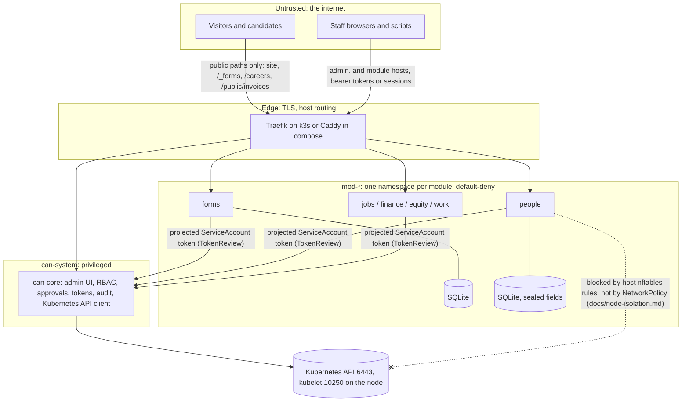

# Security model

What the system tries to guarantee, where the trust boundaries are, and the known weaknesses, gathered in one
place from the module documents and the QA rounds of each epic. **Nothing here has been penetration tested or run
on a real server.** Controls are described as built and unit-, contract- and (for the compose stack)
end-to-end tested; where a control depends on Kubernetes it is only as verified as the k3d runs say. To report a
problem see [SECURITY.md](../SECURITY.md).

## Trust boundaries

1. **Internet to edge.** Only public paths are meant to be routed: the site, the same-origin `/_forms` path,
   `/careers` and feeds, and `/public/invoices/`. Module APIs (`/v1`) are for the cluster and for authenticated
   staff; see "Exposure" below. The compose edge answers an unknown `Host` header with 421.
2. **Edge to services.** Plain HTTP inside the cluster or compose network. Modules sit in separate namespaces under
   default-deny NetworkPolicy; only can-core's module-API port is open to them.
   **Pod to node:** NetworkPolicy does not cover it on k3s. Host nftables rules installed by the server bootstrap
   drop pod traffic to the node and to cloud metadata; only system pods reach the API server
   ([node-isolation.md](node-isolation.md), [threat model](../specs/038-node-isolation/spec.md)). Tested in
   network namespaces and k3d, **not on a real server**; `make dev` clusters do not have these rules.
3. **Module to can-core.** A module proves who it is with its projected ServiceAccount token, checked by
   `TokenReview` with a dedicated audience; can-core then authorises what that module may publish, subscribe to,
   and ask. In compose a fake reviewer accepts anything, so this boundary is **not** tested there.
4. **Staff to can-core and modules.** Admin UI: password plus TOTP (a code is single use; five wrong logins lock
   the account for 15 minutes) or OIDC SSO. Modules: bearer tokens (below). Permissions are namespaced per module
   and enforced in can-core's RBAC and again in each module's own policy layer.
5. **can-core to Kubernetes.** A narrow ClusterRole; it can create workloads only in namespaces that carry the
   per-module RoleBinding, and cannot read Secrets elsewhere.

## Tokens and sessions

| Credential | Held by | Stored as | Lifetime and limits |
|---|---|---|---|
| Admin session | human, cookie `can_session` (HttpOnly, SameSite=Strict, `__Host-` over TLS) | server-side | hashed id; CSRF token on every form; `Sec-Fetch-Site` checked; `no-store` on authenticated pages |
| Personal access token `canpat_...` | human or script, shown once | SHA-256 only | 1 hour up to 90 days (365 max); bound to one module and to permissions the issuer holds; stops working when the issuer loses the right; revocable; only `user:` subjects can issue one (OIDC admins cannot yet) |
| Module bootstrap token | the module's own service account (`CAN_*_TOKEN`) | environment or Secret | at least 24 to 32 characters; refused as a person for approvals |
| Summary grant `cansum_...` (business overview) | can-core, in memory, as a hash | SHA-256 | 15 seconds, one use, one module; opens only `GET /v1/summary`; the module learns the person and their permissions there by introspection ([spec](../specs/053-business-overview/spec.md)) |
| Module service tokens (work, jobs, finance) | scripts and bots | hashed in the module's database | scoped to project, party or job; creators can only hand out what they hold; `bootstrap-admin` subject reserved |
| ServiceAccount token | a module pod | projected, audience-bound, short-lived | verified by `TokenReview` and cached |
| Webhook signature | can-core to modules | HMAC secret per module | 5-minute replay window; at-least-once, so receivers de-duplicate |
| People and jobs UI sessions | browser | server memory only, SHA-256 of a 256-bit id | the people UI keeps the token in memory to re-check it every few minutes (revocation); a restart ends every session |

Bad tokens are refused cheaply and counted per address (the address the service sees: behind a proxy it is not
told to trust, that is the proxy's, shared by everyone); **valid credentials are never throttled by other
callers' failures**. Failed-login and failed-token budgets exist in every service.

can-core's admin sign-in has no limit per account. With `CAN_TRUST_PROXY=true` (as shipped) it limits per client
address; with it off (the binary's default) it limits nothing, per address or otherwise, and failures only add a
delay: see the residual risks below.

## Sealed data, audit and erasure

- **Sealed at the application level** (XChaCha20-Poly1305 with a per-field AAD that binds the ciphertext to its
  row, keys in a keyring file readable only by the service uid): people sensitive fields (date of birth, national id,
  address, personal phone, salary), 1:1 notes, goals marked private, review answers, ratings and calibration; jobs
  candidate contact data, cover letters, notes and move reasons; equity stakeholder identity, notes, payment
  references, valuation figures and convertible terms; finance party contact data is audited on read and erasable.
  A copy of a database file without its keyring is not readable. Whoever holds both can read everything.
- **Audit before return.** Sensitive reads are written to the audit log before the value is returned and fail
  closed. can-core's log is hash-chained and append-only (database triggers refuse updates and deletes); the
  modules' logs are append-only by trigger, and finance's only purged by the retention job after a year.
- **No personal data in events.** Events carry ids and amounts only; the lead event has no name or email.
- **Retention, legal hold and erasure** exist per module (erasure pseudonymises and clears; a tombstone ledger is
  replayed after a restore so erased people do not return). Legal retention overrides erasure for issued invoices.
- **Separation of duties** is enforced in one function per module and repeated as database triggers where it
  matters: the author of an invoice, timesheet, grant or review release cannot approve it; subjects are compared
  after Unicode normalisation and case folding.
- **Deny by default.** Each sensitive module has a single policy layer; a record the caller may not see is a 404, not
  a 403. People and jobs web UIs call the same service methods as the APIs and never decide access themselves
  (a test fails if they try).

## Browser hardening

Server-rendered pages with `html/template`, no inline script or style, CSP `default-src 'none'; script-src 'none'`
(the notifications page alone allows its own `push.js`), `frame-ancestors 'none'`, `nosniff`, `no-store`,
same-origin form checks, honeypot and timing token on the public forms, strict resume download headers, a
markdown renderer with size caps in the work tracker. **HSTS is sent by neither can-core nor the compose edge:**
the production ingress must send it.

## Known residual risks

| Risk | Status | Where it is tracked |
|---|---|---|
| **Node isolation is unproven on a real server.** The host rules that keep pods off the node (issues #13, #16) have run in network namespaces, on a CI runner's systemd and in k3d only: not with `ufw` on Ubuntu or Debian, not across a reboot, not against a real cloud metadata service. Servers bootstrapped earlier do not have them until installed by hand | open; check with `can doctor --server` | [node-isolation.md](node-isolation.md), [spec](../specs/038-node-isolation/spec.md) |
| **What node isolation leaves open.** `kube-system` pods (Traefik is internet-facing) and can-core still reach the API server; module egress to private networks outside the cluster is not filtered; a trusted address stays trusted for a few seconds after its pod goes; if the rules fail to load at boot, k3s starts without them until the sync service loads them | by design | [spec](../specs/038-node-isolation/spec.md) |
| **Policy lag.** In a new default-deny namespace a pod could reach others for up to 20 s while kube-router programmed the policy | observed on k3d | [measurements](measurements/phase0-ci.md) |
| **NodePort exposure.** The bootstrap sets `ufw default allow routed`; a NodePort or LoadBalancer Service created later on a bring-your-own host may be internet-reachable despite ufw listing 22, 80, 443 | open on `ssh`; not on `hetzner`'s cloud firewall | [providers.md](providers.md) |
| **Equity quantities in plaintext.** Grant quantity, strike, schedule and ledger quantities are plain columns in SQLite (pool and dilution maths and the immutability triggers need them); only identity, notes, payment references, valuations and convertibles are sealed. Run on an encrypted volume with encrypted backups | by design, documented | [equity.md](equity.md) |
| **Equity holder identity.** Verified against the people directory only where `directory.url` is set, which can-core does not wire yet; otherwise a second actor's attestation is the control and accounts are not connected to holders, so one administrator with the board role and the service-account token can give themself a grant without break-glass. Collusion, directory or account administrators and one confirmation covering later ledger entries remain. The service-account token never carries the board role, so grants can only be approved by an identity provider that issues it | open | [equity.md](equity.md#holder-identity) |
| **SSO covers the admin UI only.** The module UIs and APIs use tokens; OIDC administrators cannot issue personal access tokens; no real identity provider has ever been tested | open | [sso.md](sso.md), [module-wiring.md](module-wiring.md) |
| **Kubernetes Secrets are not encrypted by can-core.** Encrypting Secrets at rest is a cluster setting that can-core does not assert, and anyone with `kubectl` on `mod-*` namespaces can read module secrets and keyrings | open | [module-wiring.md](module-wiring.md) |
| **The authentication code can be guessed by someone who has the password.** With `CAN_TRUST_PROXY=false` (the binary's default) nothing locks or limits sign-in: back-off only delays, about 128 guesses a second still get through, and the second factor can be expected to fall within about an hour. With it on (as shipped) the locks are per address, so many addresses mean many allowances. can-core does not prevent this; it records `admin.login.many_failures` and logs a warning after 20 failures on an account in a day | open; keep `CAN_TRUST_PROXY=true` behind Traefik, add the IP allowlist, act on the alert by changing the password | [deployment.md](../specs/005-can-core-mvp/deployment.md) |
| **can-core is privileged and internet-facing.** Mandatory TOTP, narrow ClusterRole and a minimal image, but it is the first target of any review that has not happened | open | [SPEC.md](../SPEC.md) section 11 |
| **Introspection amplification.** Every distinct bad token costs one outbound introspection call before any limit applies (the cache absorbs repeats for 5 s) | open | [people.md](people.md), [equity.md](equity.md) |
| **Database access defeats triggers and anonymity.** Immutability triggers and anonymous-feedback guarantees do not hold against someone who can write the SQLite file | by design | [equity.md](equity.md), [people.md](people.md) |
| **Event loss.** forms has no durable outbox: a lead is kept, but its event is dropped if can-core is down through all delivery attempts | open | [module-wiring.md](module-wiring.md) |
| **Approvals partly wired.** Only jobs requisitions and finance invoices use can-core's engine; others use each module's own rule; people (time off, review release) and equity have the seam but no adapter | open | [module-wiring.md](module-wiring.md) |
| **Contract signatures are simple electronic signatures.** A signer is whoever can read the mailbox the sender typed; the evidence chain is not signed with a key, so a database writer can rebuild it (only copies held outside show that); queued invitation mail holds live links | by design, documented | [spec](../specs/049-contract-esign/spec.md) |
| **Fake providers.** Finance payment and e-sign providers, jobs virus scanning and board connectors, and CAPTCHA are fakes or absent; outbound email has never been run against a real relay; no applicant email verification | open | [finance.md](finance.md), [recruiting.md](recruiting.md), [email.md](email.md) |
| **No browser, screen-reader or phone verification** of any web UI; Web Push never run against a real push service | open | [pwa.md](pwa.md), [admin-ui.md](admin-ui.md) |
| **Unpinned or placeholder images.** Release Dockerfiles and charts carry digest placeholders (`make release-check` fails until a release resolves them); the compose and CI images use unpinned tags | open until the first release | [releasing.md](releasing.md) |
| **Backups and restore never exercised on a real host.** `can restore` is non-functional beyond planning | open | [backup-restore.md](backup-restore.md) |

## The compose stack is not secure

`docker-compose.yml` and the e2e overlay use public fake tokens and passwords committed to the repository, plain
HTTP, a fake token reviewer, an introspection stub that accepts five fixed fake tokens (`dev/compose/introstub`),
unpinned base images and no resource limits. The edge listens on `127.0.0.1` only. Never expose it, never reuse its
credentials, never put real data in it ([local-compose.md](local-compose.md)).

can-core's development mode (`CAN_DEV_STACK`, used only there) replaces Kubernetes TokenReview with token files
and records modules without installing them. It is compiled in only with `-tags candevstack`; release builds
refuse to start when it is requested, as does any build inside Kubernetes ([local-compose.md](local-compose.md)).

## What the end-to-end suite checks about security

Through the real edge: every module API refuses no token and every other module's token (401); an unknown `Host`
header gets nothing (421) and reaches no API, UI or admin page; no `/metrics` or debug endpoint answers; anonymous
callers are redirected from every UI and refused by the admin API; a colleague cannot see a leave request,
salary, 1:1 series or balance; an on-leave person is masked as active to colleagues; an invoice's creator cannot
approve it; a grant's submitter and the service account cannot approve it, only a board identity can; an
unassigned interviewer sees no application and an assigned one cannot read others' feedback before submitting;
the public invoice link shows no internal field and a forged link is 404. It does **not** check TLS, NetworkPolicy,
TokenReview, SSO, rate limits, CSRF or CSP beyond a few cases: the module unit tests do.
